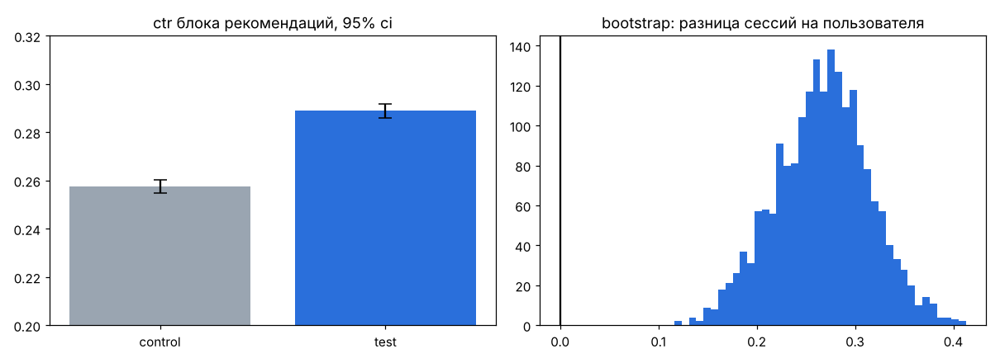
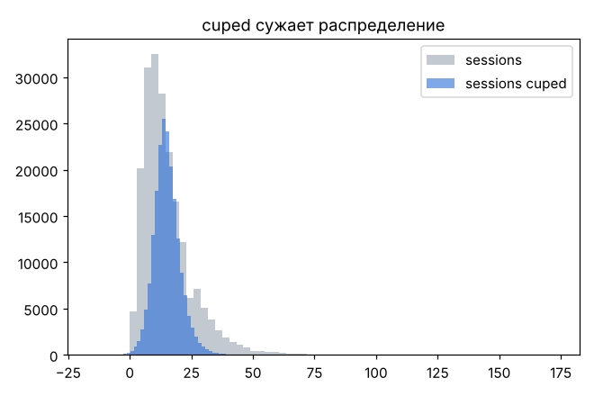
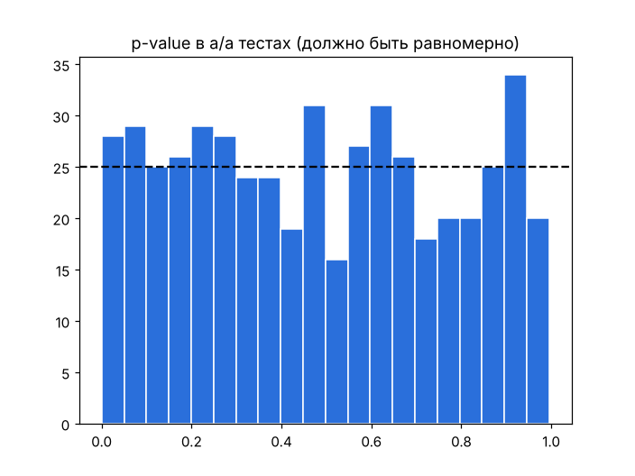

# a/b-тест блока рекомендаций в приложении оператора

в приложении оператора есть блок "рекомендуем вам" с тарифами и услугами. в тесте его переделали, и надо понять, стало ли лучше

но хотелось проверить не только сам тест, а еще и то, можно ли доверять методам. поэтому данные синтетические (200 тыс. пользователей), и эффекты в них я заложила заранее: ctr +12%, сессии +1.5%, покупки и время загрузки без изменений. если методы нашли то, что заложено, и не нашли то, чего нет, значит работают

python, sql (sqlite), scipy

## дизайн

основная метрика ctr: доля пользователей, которые хотя бы раз кликнули по блоку. до теста она была 25.7%

сколько нужно пользователей при alpha 0.05 и мощности 0.8:
- чтобы поймать +5%: 18 406 на группу
- чтобы поймать +3%: 50 813 на группу

у нас по ~100к в группе, так что даже 3% видно

srm: 99 798 vs 100 202, p = 0.37, сплит нормальный

## результаты

метрики собираются sql-запросом из `sql/metrics.sql`

| метрика | control | test | изменение | p |
|---|---|---|---|---|
| ctr | 25.75% | 28.89% | +12.2% | < 0.001 |
| сессии на пользователя | 14.99 | 15.25 | +1.8% | < 0.001 |
| покупка услуги | 3.1% | 3.1% | 0 | 0.99 |
| время загрузки, мс (guardrail) | 846 | 845 | 0 | 0.51 |



ctr через z-тест для долей. сессии через welch t-test и бутстрап (95% интервал разницы [0.17; 0.36]), потому что распределение сессий скошенное и хотелось проверить двумя способами

метрик несколько, поэтому поправка холма. ctr и сессии остаются значимыми, покупки нет, как и было заложено. время загрузки не выросло, тест ничего не сломал

## cuped

в качестве ковариаты сессии того же пользователя за 2 недели до теста. дисперсия упала на 74% (110.7 -> 28.4), то есть тот же эффект можно было бы поймать на выборке примерно в 4 раза меньше



## a/a тесты

500 раз делила контрольную группу пополам и прогоняла тот же z-тест. ложных срабатываний 5.6% при alpha 5%, это в пределах нормы (для 500 тестов ожидаемо от 3.1% до 6.9%). p-value распределены примерно равномерно, метод значимость не завышает



## итог

новый блок раскатывать: ctr +12%, сессии чуть выросли, покупки и скорость не пострадали. методы нашли ровно то, что было заложено

что не сделала: не смотрела эффект во времени (новизна могла завысить ctr в первые дни) и не считала доход, только клики

## запуск

```
pip install -r requirements.txt
python src/generate_data.py
python src/analysis.py
python src/aa_tests.py
```

запускать из корня проекта. данные в git не лежат, генерятся за пару секунд
